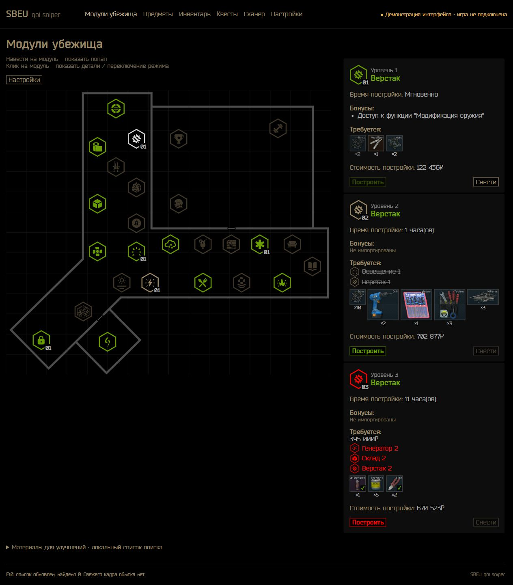
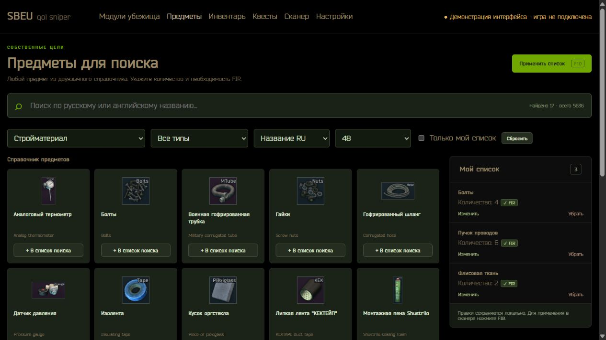
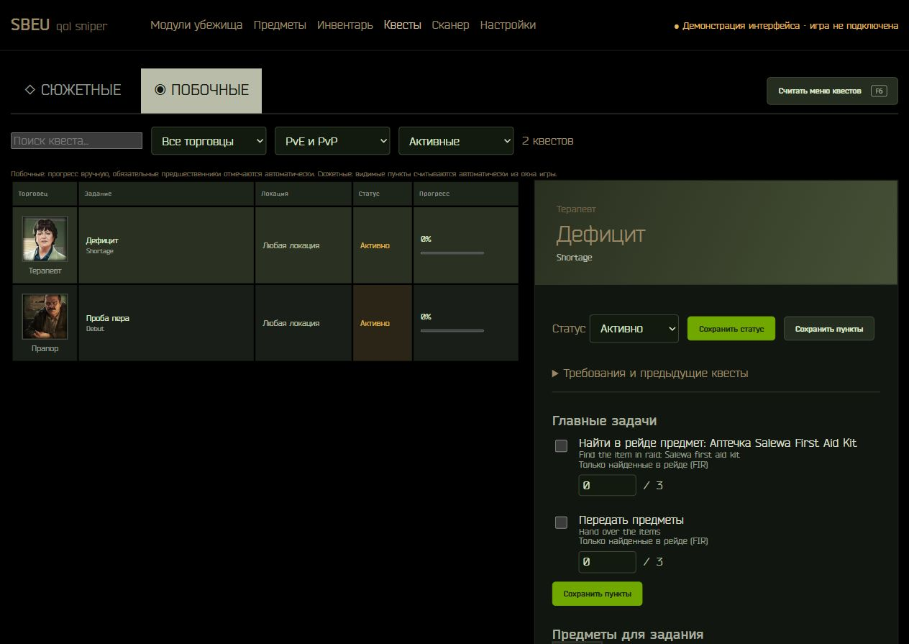
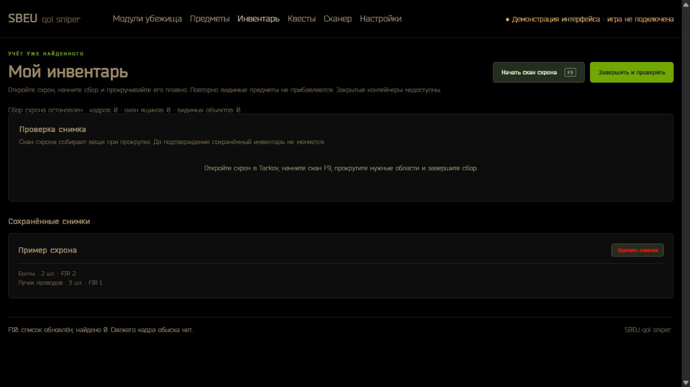
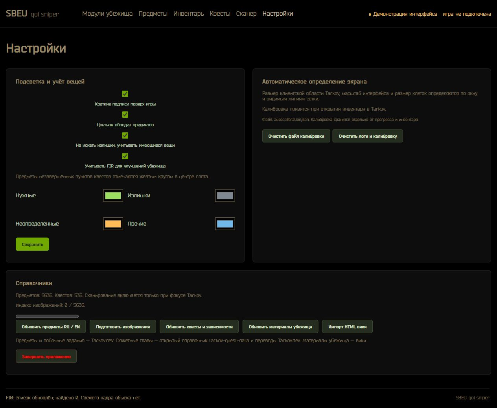

# SBEU qol sniper

Локальный экранный помощник для **Escape from Tarkov** под Windows 10/11 x64. Находит нужные предметы в добыче, разгрузке и открытых контейнерах, учитывает материалы убежища, задания и уже найденные вещи. Настройки и проверка результатов доступны в локальном webUI.

Игровые данные берутся **только из видимых пикселей экрана**: приложение не читает память процесса, игровые файлы, логи или сетевой трафик и не управляет персонажем. Этот способ работы сам по себе не гарантирует разрешение со стороны разработчика игры.



## Возможности

- Распознавание изображений из слотов и коротких названий RU/EN, включая повёрнутые предметы. Скрытые клетки проверяются после появления содержимого.
- Подсветка материалов, подписи, отдельные цвета и защита от излишков. Предметы для незавершённых пунктов активных квестов отмечаются жёлтым кругом.
- Схема убежища, редактирование уровней, автоматические зависимости и каскадное снятие зависимых улучшений.
- Поиск, категории, типы и страницы каталога; личные цели с количеством и FIR — «найдено в рейде».
- Сбор видимого схрона и открытых ящиков с проверкой количества перед сохранением.
- Побочные и сюжетные квесты, требования и пункты. Ручной прогресс, обязательные предшественники и чтение видимых сюжетных пунктов.
- Автоматическое определение окна и сетки; отдельный файл калибровки с очисткой из настроек.

Снимок справочников от 12 ноября 2026 года: **5 636 ID предметов, 536 заданий, 1 994 пункта**. Каталог включает архивные записи и может отставать от обновлений игры.

## Запуск

Для готовой сборки откройте `SBEU qol sniper.exe`, сохранив рядом папку `_internal`. Пользователю готового EXE отдельный Python не требуется. Чтение включается автоматически при запуске и фокусе окна Tarkov.

**Ветка `master` содержит исходники, а не готовый EXE.** Если в [Releases](https://github.com/Noizicrafty/sbeu-qol-sniper/releases) ещё нет сборки, используйте [инструкцию сборки](docs/SETUP.md#сборка-из-исходников).

1. Проверьте уровни убежища или считайте их с экрана через F8.
2. Добавьте личные цели в «Предметах» и примените список через F10.
3. При необходимости соберите схрон через F9, проверьте и сохраните снимок.
4. Вернитесь в игру и откройте инвентарь или контейнер. Новые слоты читаются непрерывно, без нажатия клавиши.

**[Полный гайд по установке и настройке →](docs/SETUP.md)**

| Клавиша | Действие |
|---|---|
| F6 | Считать видимое меню квестов |
| F7 | Пауза / возобновление сканера |
| F8 | Считать уровни убежища для проверки |
| F9 | Начать / завершить сбор схрона |
| F10 | Применить цели и зафиксировать список находок |

F10 не запускает распознавание и не задерживает экранную подсветку.

## Интерфейс

Снимки получены из работающего приложения с отдельным **демонстрационным профилем**. Уровни, задания и количества на них — примеры, не данные пользователя.

| Каталог и поиск | Квесты |
|---|---|
|  |  |

| Учёт схрона | Настройки |
|---|---|
|  |  |

[Экран сканера](docs/images/scanner.jpg) · [Схема убежища](docs/images/hideout.jpg)

## Скорость и ограничения

Новые изменения слотов обрабатываются независимо от общего обхода и полного OCR. После подтверждения изображения рамка передаётся сразу; короткая подпись уточняется параллельно. Целевые 30 Гц захвата и проверки рамок **не означают** полное распознавание каталога 30 раз в секунду.

В локальном повторении восьми раскрытий с загруженными моделями измерено примерно **75–170 мс от кадра до подтверждённого результата**, без физического захвата и отрисовки. Скрытие имитировалось штриховкой, пиксели раскрытого предмета были настоящими. Первое чтение двух плотных ящиков на проверяемых предметах доходило до **1,7 с**. Скорость зависит от компьютера и нагрузки.

Закрытые, перекрытые и невидимые предметы прочитать нельзя. Похожие варианты иконок могут остаться неоднозначными. Не перемещайте и не сортируйте вещи во время сбора схрона. По пикселям нельзя гарантированно различить два закрытых контейнера с одинаковым содержимым; итог нужно проверить.

Индивидуальные оперативные задания аккаунта не входят в публичный справочник. Невидимые пункты не угадываются: сюжетную главу нужно открыть и при необходимости прокрутить.

## Разработка

```powershell
py -3.13 -m venv .venv
.\.venv\Scripts\python.exe -m pip install -r requirements.txt
.\.venv\Scripts\python.exe scripts\prepare_data.py --download-images
.\.venv\Scripts\python.exe -m unittest discover -s tests -q
.\build.ps1
```

Первичная подготовка требует интернета для изображений и OCR. Полные игровые кадры для обычных тестов не нужны. Скрипты `benchmark_*` и `validate_screenshots` требуют отдельно предоставленных локальных изображений.

Публичные данные: [`reference/`](reference/README.md). Личные настройки, прогресс, кадры, модели, индекс и EXE исключены из Git. [Технические сведения](docs/TECHNICAL_NOTES.md).

## Источники

[Tarkov.dev](https://tarkov.dev/) · [Escape from Tarkov Wiki](https://escapefromtarkov.fandom.com/wiki/Hideout) · [Tarkov Market — схема убежища](https://tarkov-market.ru/progression/hideout) · [сюжетный справочник](https://szepiz.github.io/tarkov-quest-data/api/maps.json).

Атрибуция интерфейса, шрифтов и игровых ресурсов: [NOTICE](itemsniper/web/assets/NOTICE.md). Сторонние материалы принадлежат их правообладателям. Это не официальный продукт Battlestate Games или Tarkov Market.
