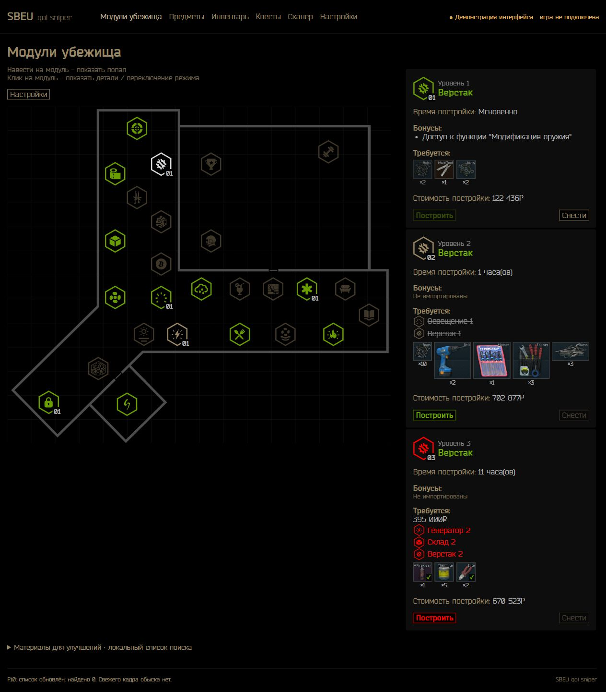
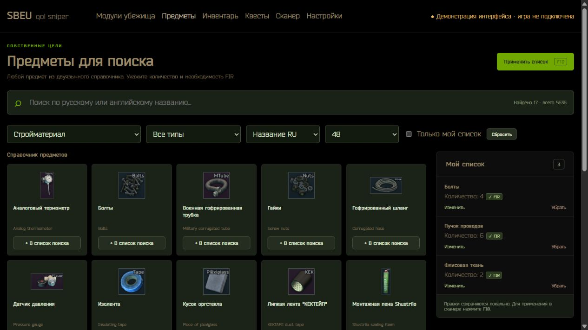
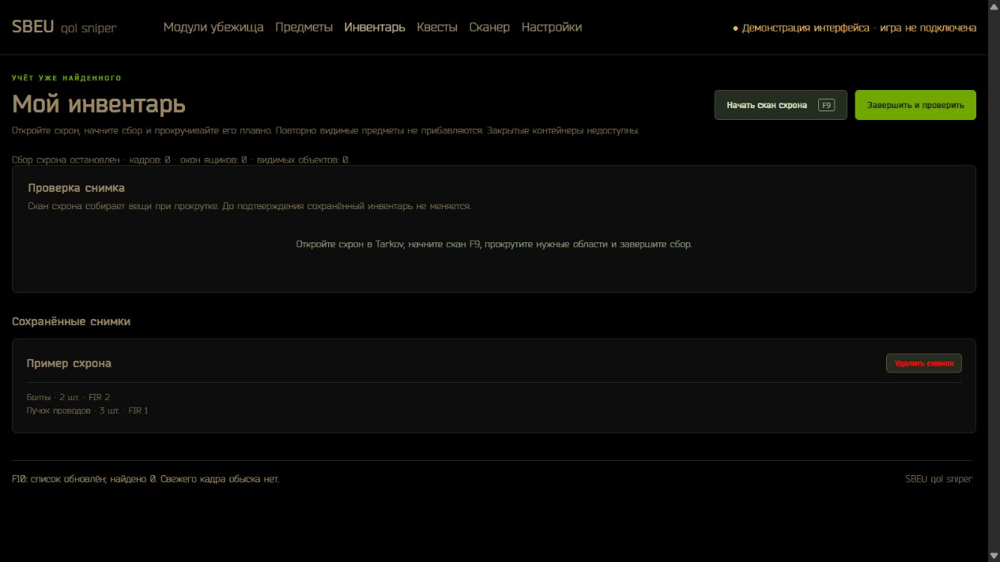
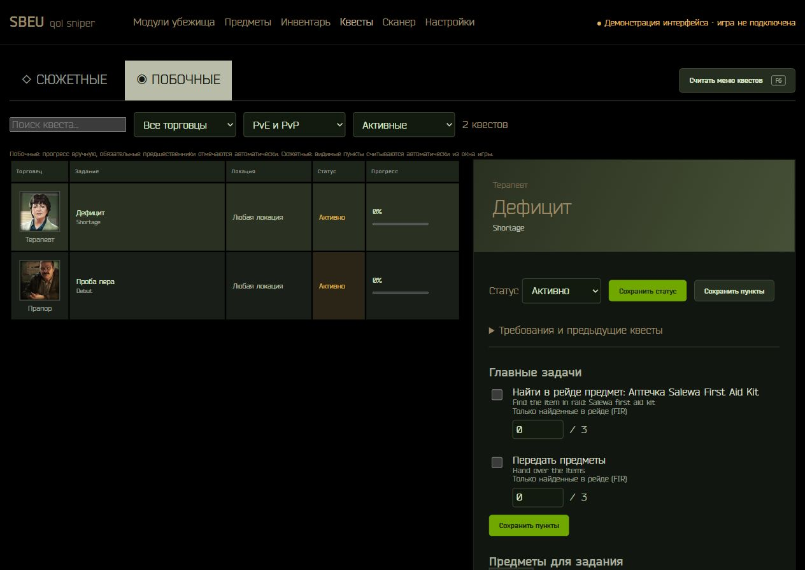
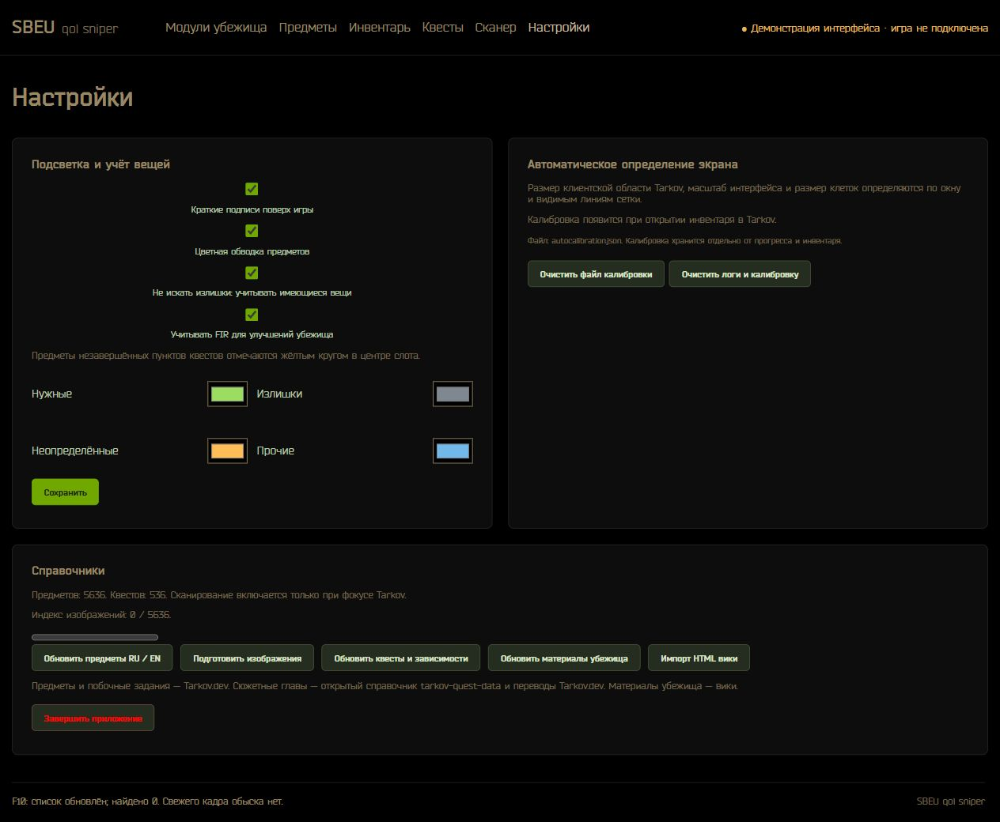
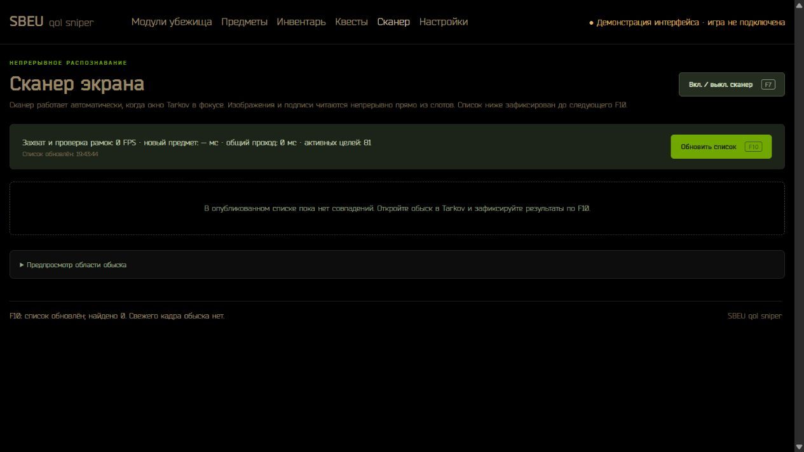

# Установка и настройка

## Готовая сборка EXE

Платформа: Windows 10/11 x64. Настройки открываются в браузере на локальном адресе `127.0.0.1`. Отдельный Python для готовой сборки не требуется.

1. Распакуйте всю папку сборки в доступный для записи каталог.
2. Проверьте, что рядом с `SBEU qol sniper.exe` лежит `_internal`. Один EXE не переносится отдельно.
3. Запустите EXE. Повторный запуск открывает webUI уже работающего экземпляра.
4. Запустите Tarkov и верните фокус в игру. Рекомендуется оконный режим без рамки: эксклюзивный полный экран может мешать внешней подсветке.

В Git находятся исходники. Готовые архивы, если опубликованы, доступны в Releases; иначе выполните сборку ниже.

## Первый запуск

### Убежище

На вкладке «Модули убежища» задайте подтверждённые уровни либо считайте видимую информацию в игре через F8 и проверьте предложения. Невидимые уровни из одного кадра не определяются.

Повышение уровня автоматически отмечает необходимые предыдущие модули. Снижение снимает зависимые улучшения каскадно. Навыки и требования торговцев автоматически выполненными не считаются.



### Личные цели

В «Предметах» ищите по названию RU/EN или ID. Используйте категории, типы, сортировку и страницы. Укажите количество и при необходимости FIR — «найдено в рейде».

После правок нажмите **F10**. Эта клавиша применяет цели и фиксирует список в webUI; экранное распознавание и подсветка работают независимо.



### Схрон и ящики

1. Откройте схрон и начните сбор через F9 или кнопку webUI.
2. Прокручивайте плавно, оставляя общую часть между кадрами.
3. Откройте ящики. Одноимённые окна обрабатываются отдельно, перекрытые участки исключаются.
4. Закройте окна, чтобы дочитать скрытую ими часть основного схрона.
5. Завершите сбор повторным F9, проверьте количества и FIR, сохраните снимок.

Не сортируйте и не переносите вещи во время сбора. Не суммируйте повторные непроверенные снимки одного содержимого. По пикселям нельзя надёжно различить два закрытых одинаково заполненных контейнера — проверьте итог вручную.



### Квесты

Используйте поиск и фильтры режима, торговца и статуса. Откройте задание, укажите статус и прогресс пунктов, сохраните изменения. У позднего побочного задания обязательные завершённые предшественники отмечаются автоматически. Условие «выполнить или провалить» не превращается в безусловное выполнение.

F6 читает видимые строки меню заданий. В открытой сюжетной главе видимые флажки и счётчики читаются автоматически. Для других пунктов откройте/прокрутите главу. Предметы выполненных пунктов перестают подсвечиваться, если не нужны другому активному пункту.



### Подсветка и калибровка

В «Настройках» включаются подписи, обводка и защита от излишков, выбираются цвета. Защита учитывает подтверждённый схрон и видимые вещи персонажа.

Размер окна, DPI, масштаб и сетка определяются автоматически. Если рамки сместились, очистите калибровку и снова откройте инвентарь. Очистка калибровки и журналов не удаляет подтверждённый прогресс.



## Статус и управление

| Цвет | Значение |
|---|---|
| Зелёный | Чтение подходящего экрана |
| Жёлтый | Ожидание игры, фокуса или подходящего меню |
| Красный | Ошибка, остановка или потеря связи |

| Клавиша | Действие |
|---|---|
| F6 | Чтение меню квестов |
| F7 | Пауза / возобновление |
| F8 | Чтение уровней убежища |
| F9 | Начало / завершение сбора схрона |
| F10 | Применение целей и фиксация списка |

Чтение приостанавливается при потере фокуса Tarkov. Команда из webUI может ждать возврата в игру. Если бинд занят, используйте кнопку в браузере.

«Сканер» отдельно показывает частоту кадров, время нового распознавания и общий проход. FPS захвата не равен скорости полного распознавания каталога.



## Где находятся данные

Перенесённая готовая сборка хранит профиль в `%LOCALAPPDATA%\SBEU qol sniper`. Исходники и сборка рядом с рабочим проектом используют `data/` проекта, если он существует.

| Файл / папка | Содержимое |
|---|---|
| `state.json` | Уровни, цели, снимки и прогресс |
| `autocalibration.json` | Автоматическая калибровка |
| `catalog.json`, `progression.json` | Публичные справочники |
| `library/`, `visual-index.npz` | Изображения и индекс |
| `logs/` | Локальные журналы |

Для резервной копии завершите приложение и скопируйте профиль. Свою `data/` не публикуйте: она исключена через `.gitignore`.

## Сборка из исходников

Нужны Windows x64, Git и Python 3.13 x64. Команды выполняются в PowerShell из корня проекта.

```powershell
git clone --branch master https://github.com/Noizicrafty/sbeu-qol-sniper.git
cd sbeu-qol-sniper
py -3.13 -m venv .venv
.\.venv\Scripts\python.exe -m pip install -r requirements.txt
.\.venv\Scripts\python.exe scripts\prepare_data.py --download-images
```

Подготовка копирует публичные справочники из `reference/`, не заменяя существующие файлы, загружает изображения слотов и модели OCR, строит индекс. Нужен интернет; при ошибках повторите ту же команду. Загрузка всего каталога занимает время.

Запуск исходников:

```powershell
.\.venv\Scripts\python.exe -m itemsniper
```

Первое обращение к OCR в разработческой среде может загрузить модели. Для сборки:

```powershell
.\.venv\Scripts\python.exe -m unittest discover -s tests -q
.\build.ps1
```

Результат: `dist\SBEU qol sniper\SBEU qol sniper.exe` и `_internal`. Передавайте всю папку `dist\SBEU qol sniper`, без своей `data/`.

Проверка готового EXE с отдельным тестовым профилем:

```powershell
& '.\dist\SBEU qol sniper\SBEU qol sniper.exe' --self-test --data-dir '.\build\self-test'
```

Успех записывается в `build\self-test\self-test.json`. Проверяются модели, индекс, webUI и новый путь распознавания. Обычные тесты используют небольшие фикстуры; скриптам `benchmark_*` и `validate_screenshots` нужны отдельно предоставленные игровые кадры.

## Частые проблемы

**Жёлтый статус.** Вернитесь в Tarkov и откройте инвентарь. Окно настроек в браузере не является фокусом игры. Приложение определяет видимое окно Unity с названием Tarkov.

**Нет рамок / они смещены.** Проверьте обводку и паузу сканера. Попробуйте режим без рамки, очистите калибровку и снова откройте инвентарь.

**Медленное чтение.** Дождитесь загрузки моделей. Новые раскрытия имеют приоритет, но первое чтение большого числа вещей дольше; похожим иконкам может понадобиться уточнение по подписи. Описанные в README измерения не гарантируют одинаковую скорость на другом компьютере.

**Неверный остаток.** Проверьте FIR, уровни, снимки и прогресс пунктов. Исключите дубли снимков и примените цели F10.

**Устаревшие требования.** В настройках есть обновление справочников и импорт вики. Если автоматическое чтение вики недоступно, используйте импорт сохранённого HTML.

**EXE не запускается после копирования.** Проверьте наличие `_internal` и целостность всей папки сборки.
